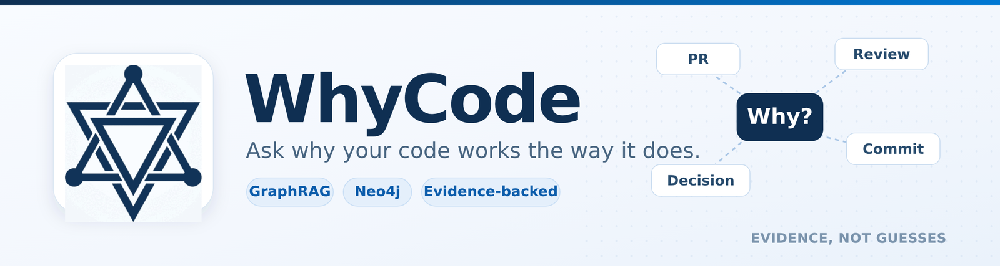
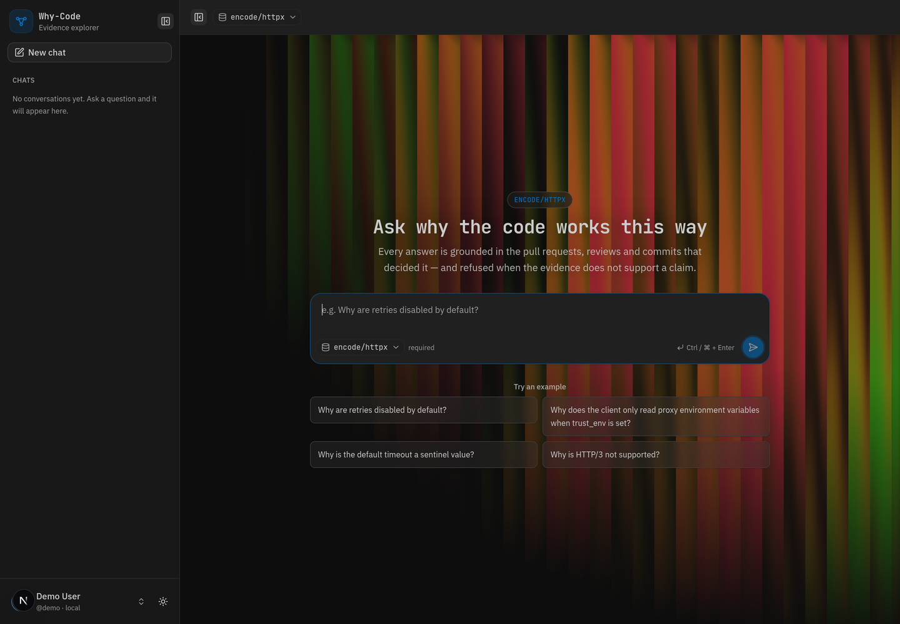
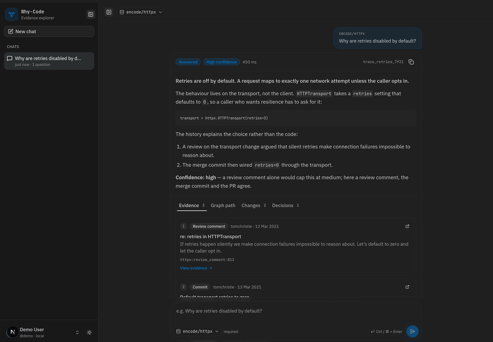
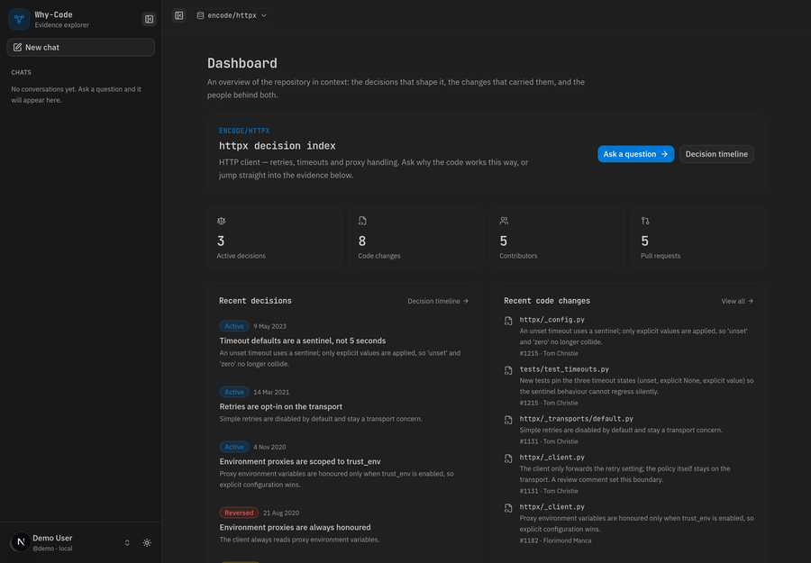
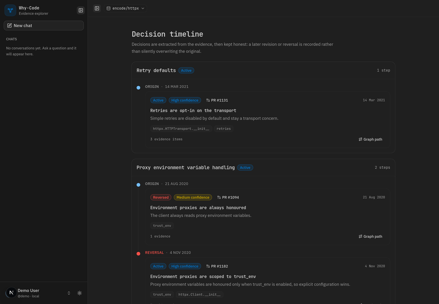
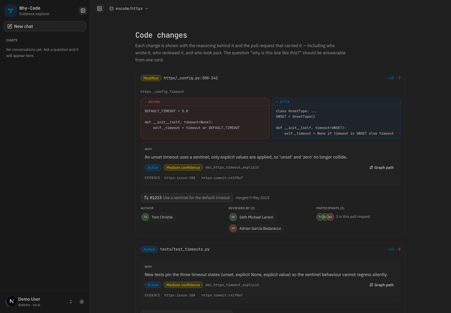
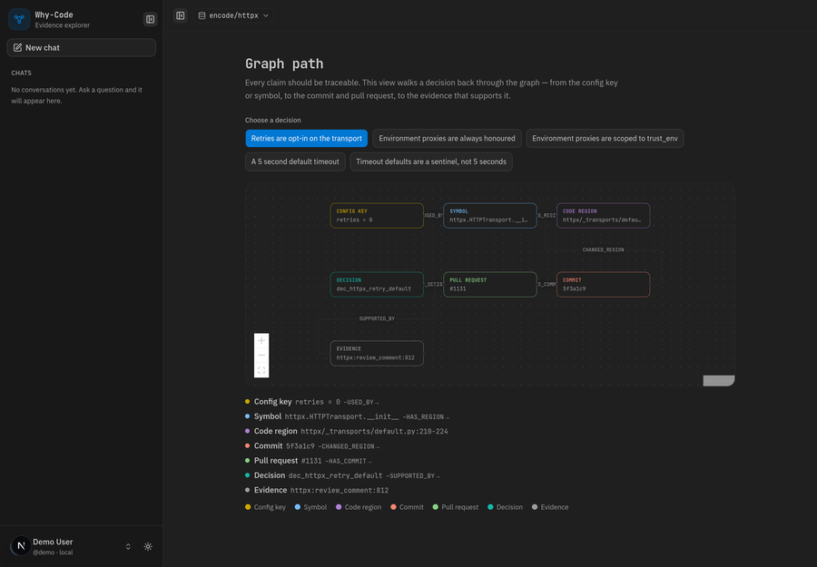
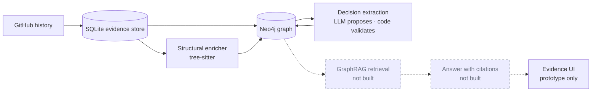

<div align="center">
  
</div>

<p align="center">
  <b>Ask why your code works the way it does — and see the evidence.</b><br/>
  <sub>GraphRAG over a repository's pull requests, reviews, commits and issues.</sub>
</p>

<p align="center">
  
  
  
  
  
  
</p>

**WhyCode** explains *why* a codebase works the way it does, using its own development history as evidence. It ingests merged pull requests and the conversation around them, builds a Neo4j graph of files, symbols, regions, people and decisions, and extracts evidence-linked engineering decisions. Every claim is traceable; when the evidence is insufficient, the system refuses instead of guessing.

> [!IMPORTANT]
> **Work in progress.** The backend pipeline through decision extraction is implemented and tested. The GraphRAG answer service and the published UI are not built yet — see [Built vs. what's left](#built-vs-whats-left).

## Screenshots

The UI below is the current **local prototype**, running on bundled fixture data. The frontend source is not published in this repository yet; the screenshots show the intended product experience.

<p align="center">
  
</p>
<p align="center"><sub><b>Ask.</b> Pick a repository, ask a “why” question, or start from an example.</sub></p>

<p align="center">
  
</p>
<p align="center"><sub><b>Answer with evidence.</b> Confidence is categorical, every citation opens, and the graph path is inspectable.</sub></p>

| Dashboard | Decision timeline |
| :---: | :---: |
|  |  |
| Active decisions, changes and contributors at a glance. | Decisions keep their history — including reversals. |

| Code changes | Graph path |
| :---: | :---: |
|  |  |
| The diff, the reason and the people behind it. | Config key → symbol → region → commit → PR → evidence. |

## How it works



The LLM is a **proposer**, never the authority: deterministic code validates every citation against the evidence store and graph, computes confidence, detects supersession, and writes the graph.

## Quick start

**Prerequisites:** Python 3.12+, a GitHub token, a Neo4j AuraDB (or local Neo4j) instance, and an OpenAI-compatible API key.

```bash
git clone https://github.com/shivamsingh-007/Why-Code.git
cd Why-Code/backend

python3 -m venv .venv
source .venv/bin/activate
pip install -e '.[dev]'

cp .env.example .env      # fill in the values
set -a; source .env; set +a
```

Settings are read from environment variables; `.env` is not auto-loaded, hence the `source` line.

### Run the API

```bash
PYTHONPATH=. uvicorn app.main:create_app --factory --reload
curl http://localhost:8000/health
# {"service":"why-code","status":"ok","version":"0.0.1"}
```

Only `/health` exists today. The answer API (`POST /api/v1/ask`) is part of the unbuilt retrieval component.

### Run the pipeline

```bash
# 1. Ingest merged PRs and normalize their history
PYTHONPATH=. python -m app.ingestion.cli ingest \
  --repo encode/httpx --since 2024-01-01 --limit 100 \
  --artifacts-dir ../artifacts

# 2. Enrich changed files with tree-sitter and load the graph
PYTHONPATH=. python -m app.structural.cli build \
  --repo encode/httpx \
  --normalized ../artifacts/normalized.jsonl \
  --high-signal ../artifacts/high_signal_prs.jsonl \
  --artifacts-dir ../artifacts --remote --write

# 3. Extract evidence-linked decisions (dry run; add --write to load Neo4j)
PYTHONPATH=. python -m app.intent.cli extract \
  --repo encode/httpx \
  --normalized ../artifacts/normalized.jsonl \
  --high-signal ../artifacts/high_signal_prs.jsonl \
  --structural-graph ../artifacts/structural/structural_graph.jsonl \
  --db ../artifacts/evidence.db \
  --artifacts-dir ../artifacts
```

Generated artifacts land in `artifacts/` and are git-ignored.

### Verify the build

```bash
PYTHONPATH=. python -m pytest --ignore=tests/structure
ruff check app tests
mypy app
```

Current result: **641 passed, 8 skipped**, ruff clean, mypy clean. The 8 skips are opt-in live-Neo4j tests.

> `tests/structure/` is a legacy parallel contract suite that conflicts with `tests/structural/` at collection time. The canonical suite excludes it.

## Built vs. what's left

| Plan component | Status | What exists | What's missing |
| --- | :---: | --- | --- |
| **0 · Foundation** | ✅ | Typed settings, error taxonomy, structured logging, evidence records/IDs, `/health`, tests | CI workflow and Docker Compose were deliberately cut (D-0005) |
| **1 · GitHub ingestion** | ✅ | Merged-PR client, normalizer, SQLite store, relevance scoring, JSONL exports, ingestion report, CLI | Live 50–100 PR acceptance run is not reproduced in the repo (needs a token) |
| **2 · Neo4j graph builder** | ✅ | Graph mapping, commit-scoped regions, batched `MERGE` writer, constraints/indexes, integrity checks | Live AuraDB load is opt-in and was not executed here |
| **3 · Structural enricher** | ✅ | Tree-sitter Python symbols/imports/references, YAML/TOML/env config keys, docs, regions, validation | Python only; JS/TS/Rust and lock files are skipped by design |
| **4 · Decision extractor** | ✅ | Candidate detection, context packing, strict schemas, evidence/claim/rule gates, confidence, supersession, dedupe, review queue, Neo4j writer | Live LLM acceptance (≥10 decisions on 20 PRs) not demonstrated in this repo |
| **5 · GraphRAG retrieval** | ❌ | — | Query planner, hybrid retrieval, graph expansion, context packing for answers, synthesis with citations, refusal policy, `/api/v1/*` |
| **6 · Evidence UI** | 🟡 | Local Next.js prototype (screenshots above) | Source not published; no live API integration; not deployed |

**Also not done:** golden-question suite, embeddings/vector index, Aura Agent/MCP integration, CI and Docker, live acceptance evidence for Components 1–4.

## Project layout

```text
.
├── backend/
│   ├── app/
│   │   ├── core/          # settings, errors, logging
│   │   ├── domain/        # evidence records + stable IDs
│   │   ├── ingestion/     # Component 1  → README
│   │   ├── graph/         # Component 2  → README
│   │   ├── structural/    # Component 3  → README
│   │   ├── intent/        # Component 4  → README
│   │   ├── retrieval/     # Component 5  (not built)
│   │   └── main.py        # FastAPI factory; /health only
│   ├── tests/             # 641 tests, grouped by component
│   └── README.md          # backend guide
├── docs/                  # decisions and validation reports
├── assets/readme/         # banner + screenshots
├── artifacts/             # generated outputs (git-ignored)
└── README.md
```

## Component documentation

| Component | Documentation |
| --- | --- |
| Foundation | [`backend/README.md`](backend/README.md) |
| 1 · Ingestion | [`backend/app/ingestion/README.md`](backend/app/ingestion/README.md) |
| 2 · Graph builder | [`backend/app/graph/README.md`](backend/app/graph/README.md) |
| 3 · Structural enricher | [`backend/app/structural/README.md`](backend/app/structural/README.md) |
| 4 · Decision extractor | [`backend/app/intent/README.md`](backend/app/intent/README.md) |
| 5 · Retrieval | [`backend/app/retrieval/README.md`](backend/app/retrieval/README.md) |
| Product decisions | [`docs/DECISIONS.md`](docs/DECISIONS.md) |
| Ingestion report | [`docs/INGESTION_REPORT.md`](docs/INGESTION_REPORT.md) |
| Validation report | [`docs/VALIDATION_REPORT_PHASE10.md`](docs/VALIDATION_REPORT_PHASE10.md) |

## Configuration

| Variable | Required | Default | Purpose |
| --- | :---: | --- | --- |
| `WHYCODE_GITHUB_TOKEN` | ✅ | — | GitHub API token for ingestion |
| `WHYCODE_NEO4J_URI` | ✅ | — | AuraDB/local Bolt URI |
| `WHYCODE_NEO4J_USER` | ✅ | — | Neo4j user |
| `WHYCODE_NEO4J_PASSWORD` | ✅ | — | Neo4j password |
| `WHYCODE_NEO4J_DATABASE` | — | `neo4j` | Target database |
| `WHYCODE_LLM_API_KEY` | ✅ | — | OpenAI-compatible key |
| `WHYCODE_LLM_MODEL` | — | `gpt-4o-mini` | Extraction model |
| `WHYCODE_LLM_BASE_URL` | — | `https://api.openai.com/v1` | Compatible endpoint |
| `WHYCODE_LLM_TIMEOUT_SECONDS` | — | `60` | LLM request timeout |
| `WHYCODE_ARTIFACTS_DIR` | — | `artifacts` | Output directory |
| `WHYCODE_TEST_NEO4J_URI` | — | — | Enables live Neo4j tests |

---

<p align="center">
  <sub>FastAPI · Pydantic · SQLite · tree-sitter · Neo4j · Next.js prototype</sub>
</p>
